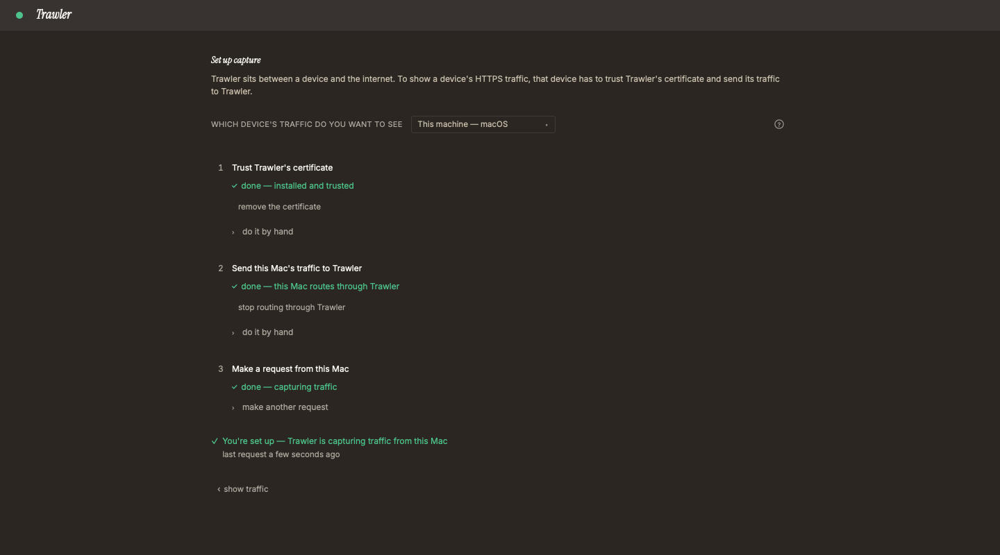
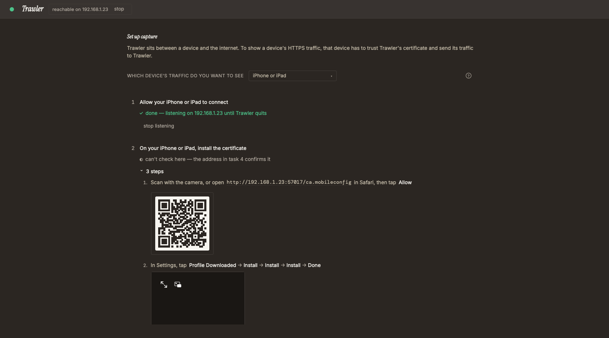
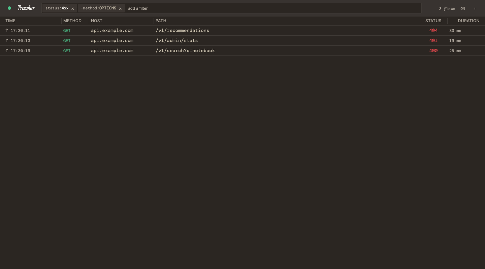
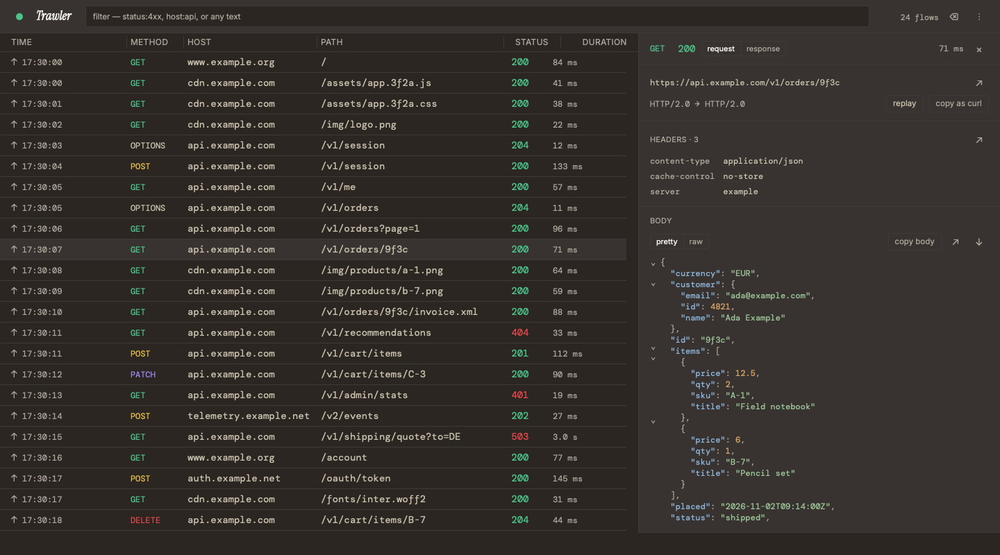
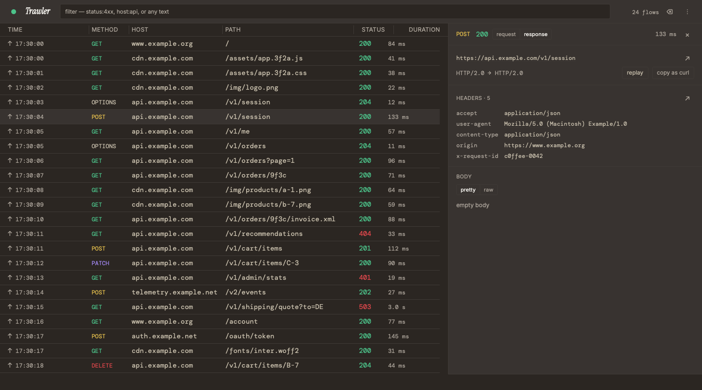
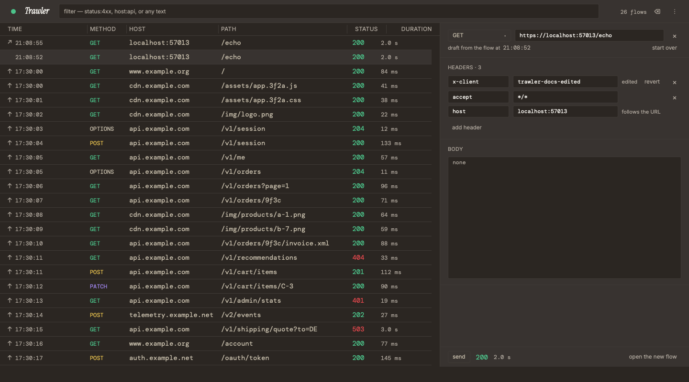
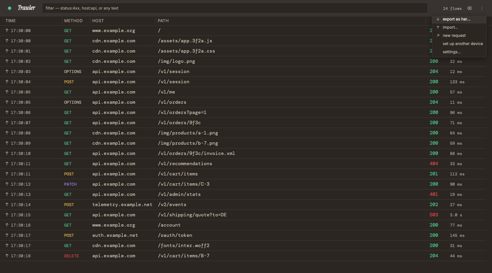
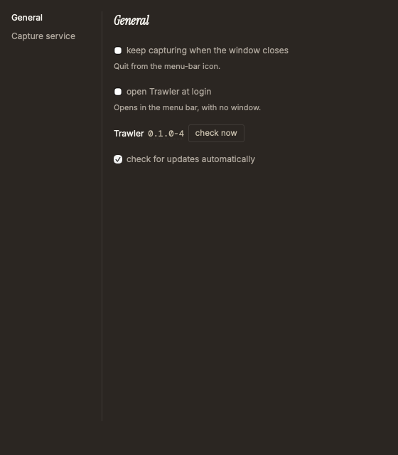

# Trawler User Guide

Trawler shows every HTTP and HTTPS request your apps make. This guide walks through each task, step by step. What Trawler keeps and what it sends: [PRIVACY.md](PRIVACY.md).

In Trawler, **Help → User Guide** (**F1**) opens this guide; on macOS it is **Help → Trawler User Guide**.

1. [Install](#install)
2. [First run](#first-run)
3. [Trust the certificate](#trust-the-certificate)
4. [Capture another device](#capture-another-device)
5. [Capture one app](#capture-one-app)
6. [Filter the list](#filter-the-list)
7. [Inspect a request](#inspect-a-request)
8. [Send a request again](#send-a-request-again)
9. [Export and import](#export-and-import)
10. [Keep capturing](#keep-capturing)
11. [Updates](#updates)
12. [Uninstall](#uninstall)
13. [Troubleshooting](#troubleshooting)

## Install

Download the file for your system from the [latest release](https://github.com/lesslucifer/Trawler/releases/latest).

| System | File |
|---|---|
| macOS 11 or later (Apple Silicon and Intel) | `Trawler_<version>_universal.dmg` |
| Windows x64 | `Trawler_<version>_x64-setup.exe` (or the `.msi`) |
| Windows arm64 | `Trawler_<version>_arm64-setup.exe` (or the `.msi`) |
| Linux x64 | `.AppImage` or `.deb`; `.rpm` in final releases |
| Linux arm64 | `.AppImage` or `.deb`; `.rpm` in final releases |

Trawler isn't signed with a paid certificate. The first time you open it, macOS and Windows warn that they don't know the publisher. Check your download first, then follow the steps for your system. You do this once: updates install from inside Trawler.

### Check your download

Download `SHA256SUMS` from the same release into the folder with your file, then run:

- macOS: `shasum -a 256 -c SHA256SUMS --ignore-missing`
- Linux: `sha256sum -c SHA256SUMS --ignore-missing`
- Windows (PowerShell): `(Get-FileHash .\<file> -Algorithm SHA256).Hash`, then compare it with that file's line in `SHA256SUMS`.

Your file must say `OK`, or the two hashes must match. If they don't, the download is damaged or was changed: delete it and download it again.

### macOS

1. Open the `.dmg` and drag **Trawler** to **Applications**.
2. Open Trawler from Applications. macOS says it can't verify the app. Click **Done**.
3. Open **System Settings → Privacy & Security**. Scroll down to the message about Trawler and click **Open Anyway**.
4. Click **Open Anyway** again and enter your password.

On macOS 11 and 12, step 3 is in **System Preferences → Security & Privacy → General**. The wording differs slightly on older versions: if the warning has no **Done**, close it without moving Trawler to the Bin (Trash).

### Windows

1. Run the `-setup.exe` (or the `.msi`).
2. If **Windows protected your PC** appears, click **More info**, then **Run anyway**.
3. Finish the installer, then open Trawler from the Start menu.

### Linux

There's no prompt to get past.

- AppImage: `chmod +x Trawler_<version>_amd64.AppImage`, then run it. Keep the file where it is if you turn on **open Trawler at login**.
- `.deb`: `sudo apt install ./Trawler_<version>_amd64.deb`
- `.rpm`: `sudo dnf install ./Trawler-<version>-1.x86_64.rpm`

On arm64 the files end in `_aarch64.AppImage`, `_arm64.deb` and `.aarch64.rpm`. On GNOME, the tray icon needs the AppIndicator extension.

Next: [First run](#first-run).

## First run

Trawler opens on the setup screen, **Set up capture**, and keeps opening there until it has decrypted an HTTPS request. Later, open it with **⋮ → set up another device**, or click the status dot at the top left of the window.

1. In **which device's traffic do you want to see**, pick **This machine — macOS**, **This machine — Windows** or **This machine — Linux**.
2. Work through the three tasks. Each one shows its status: **✓ done**, **○ not done**, or **⚠ not working** with what to do next.
   1. **Trust Trawler's certificate**: Trawler can then read HTTPS ([Trust the certificate](#trust-the-certificate)).
   2. **Send this Mac's traffic to Trawler** (**this PC's** on Windows, **this machine's** on Linux): points the system proxy at Trawler.
   3. **Make a request from this Mac**: click **make a request to example.com**, or open any HTTPS site.
3. When it says **You're set up — Trawler is capturing traffic**, click **‹ show traffic** to see the list.

The **?** button at the top right of the screen, **show notes**, adds a short note to steps where something can go wrong.

## Trust the certificate

To read HTTPS, Trawler decrypts it with its own certificate, **Trawler Proxy CA**. Trawler makes it the first time it runs; it is unique to your install. Your system decrypts nothing through Trawler until it trusts that certificate, and it sends nothing to Trawler until its proxy points there. The setup screen does both.

Pick **This machine** in **which device's traffic do you want to see**.

### macOS

Click **set up this Mac** and enter your password once. It trusts the certificate for every user of this Mac and points the proxy of each network service at Trawler. If another proxy is set, Trawler asks **Replace the proxy this machine uses?** first; it never puts the other proxy back.

To do it by hand, open **do it by hand** under each task:

1. Click **open in Keychain Access**. Search `Trawler`, double-click **Trawler Proxy CA** and set **Trust → When using this certificate → Always Trust**.
2. Close the window and enter your password.
3. Under the second task, click **open Proxy settings**, then **Wi-Fi → Details… → Proxies**. Turn on **Web proxy (HTTP)** and **Secure web proxy (HTTPS)**, each with server `127.0.0.1` and port `7420`. Click **OK**. On Ethernet, pick Ethernet in place of Wi-Fi.

### Windows

Click **set up this PC** and approve once. It trusts the certificate for every user of this PC and points your account's proxy at Trawler. If another proxy is set, Trawler asks **Replace the proxy this machine uses?** first; it never puts the other proxy back.

To do it by hand:

1. Click **open the certificate**, then **Install Certificate… → Next**. Choose **Place all certificates in the following store → Browse… → Trusted Root Certification Authorities**, click **OK → Next → Finish**, and **Yes** on the warning.
2. Under the second task, click **open Proxy settings**, then **Manual proxy setup → Use a proxy server → Set up**. Turn on **Use a proxy server** with `127.0.0.1` and port `7420`, and click **Save**.

If nothing arrives, turn off **Automatically detect settings** and **Use setup script** on the same page: either one outranks the proxy. Apps that were already open may need a restart.

### Linux

Trawler can't change these for you on Linux. Each place below keeps its own list of trusted certificates, so add it to the ones you use. The steps are Ubuntu's; other systems name them differently.

1. Under the first task, click **save…** and keep `trawler-ca.pem` in Downloads.
2. Firefox: **Settings → Privacy and security → Connection and software security → Advanced settings → Manage certificates → Authorities → Import…**, choose `trawler-ca.pem`, tick **Trust this CA to identify websites** and click **OK**.
3. Chrome or Chromium: **Settings → Privacy and security → Security → Manage certificates → Local certificates → Installed by you → Trusted Certificates → Import** and choose `trawler-ca.pem`.
4. curl and the system's tools:
   `sudo cp "$(xdg-user-dir DOWNLOAD)/trawler-ca.pem" /usr/local/share/ca-certificates/trawler-ca.crt && sudo update-ca-certificates`
5. Under the second task, click **open Network settings**, then **Proxy → Network Proxy → Configuration → Manual**. Set **HTTP Proxy** and **HTTPS Proxy** to `127.0.0.1`, port `7420`, and click **Save**. Firefox and Chrome follow this proxy; terminal tools read `HTTPS_PROXY` instead ([Capture one app](#capture-one-app)).

### Check it worked

Click **make a request to example.com**. When it says **example.com answered through Trawler.**, you're set. If it says **the request reached Trawler and didn't decrypt.**, restart your browser: it reads the trusted list when it starts.

Trawler stores the certificate's private key unencrypted in its app data folder ([SECURITY.md](SECURITY.md#about-trawlers-certificate)). While the certificate is trusted, anyone who can read your user files could use that key to read your HTTPS. Remove it when you stop using Trawler ([Uninstall](#uninstall)).

## Capture another device

Pick the device in **which device's traffic do you want to see**: **iPhone or iPad**, **Android device**, **iOS Simulator** (on a Mac), **Android emulator**, **Another Mac**, **Another Windows PC** or **Another Ubuntu machine**. The setup screen shows that device's tasks, with a QR code where the device has a camera.

### Allow another device

Phones and other computers reach Trawler over your network, so Trawler has to accept them first. Simulators and emulators run on this machine and skip this step.

1. Under the first task, click **allow devices on <network> to connect**.
2. In **Let other devices reach Trawler?**, click **Allow**.

Anything on that network can then send traffic through Trawler and read and clear what it captured. Trawler listens on that one address until you click **stop listening** (or **stop** beside **reachable on <address>** at the top of the window), or until it quits. Nothing is saved: allow it again the next time you open Trawler.

The setup screen then shows the **server** and **port** the device uses as its proxy.

### iPhone or iPad

1. Scan the code with the camera, or open the address shown with it in Safari, then tap **Allow**.
2. In Settings, tap **Profile Downloaded → Install → Install → Install → Done**. It asks for your passcode on the way.
3. Turn on full trust: in Settings, tap **General → About → Certificate Trust Settings**, then turn on **Trawler Proxy CA → Continue**. Installing alone doesn't trust it.
4. In Settings, tap **Wi-Fi**, then **ⓘ** by your network, then **Configure Proxy → Manual**. Enter the server and port from the setup screen and tap **Save**.
5. Open any HTTPS site.

### Android device

1. Scan the code with the camera, or open the address shown with it in the browser. It downloads Trawler's certificate.
2. In Settings, search `CA certificate`, then tap **CA certificate → CA certificate → Install anyway** and the `trawler-ca` file at the top of **Recent**.
3. Under the third task, scan the code (or open its address), tap **Open Wi-Fi settings**, then **⚙** by your network, then **✎ → Advanced options → Proxy → Manual**. Enter the server and port in **Proxy hostname** and **Proxy port** and tap **Save**. Phone makers move this menu; look for **Proxy**, often under **Advanced options**.
4. Open any HTTPS site in Chrome.

Chrome trusts Trawler's certificate. Another app trusts it only if the app opts in to user certificates.

### iOS Simulator

On a Mac, with the Simulator running, click **set up the Simulator**. It trusts the certificate in every Simulator running now, and points this Mac's proxy at Trawler: the Simulator uses this Mac's proxy. A Simulator you create or erase later needs it again.

### Android emulator

With the emulator running, click **set up the emulator**. It installs the certificate and points the emulator's proxy at Trawler (`10.0.2.2:7420`, the emulator's name for this machine).

On an emulator image without root access, such as a Google Play image, Trawler can't install the certificate itself. Click **send it to the emulator**, then tap **Encryption & credentials → Install a certificate → CA certificate → Install anyway → ☰ → Downloads → trawler-ca.cer**.

### Another computer

Pick **Another Mac**, **Another Windows PC** or **Another Ubuntu machine**. You don't install Trawler there. After you allow it, the setup screen shows the address to open on that computer to download the certificate, and the steps to trust it and set its proxy, as in [Trust the certificate](#trust-the-certificate).

## Capture one app

To capture a single program without changing the system proxy, point it at Trawler's proxy, `127.0.0.1:7420`:

- curl: `curl -x http://127.0.0.1:7420 https://example.com`
- Most terminal tools read the proxy from the environment: `export HTTPS_PROXY=http://127.0.0.1:7420 HTTP_PROXY=http://127.0.0.1:7420`. Undo it with `unset HTTPS_PROXY HTTP_PROXY`.

The program must also trust Trawler's certificate: the system's trusted list after [Trust the certificate](#trust-the-certificate), or the `trawler-ca.pem` file from **save…** on the setup screen if the program takes a certificate file of its own.

## Filter the list

Type in the filter at the top of the window: **filter — status:4xx, host:api, or any text**. Press **⌘F** (macOS) or **Ctrl+F** (Windows, Linux) to jump to it. Press **Enter** or **Space** to turn what you typed into a chip. Remove a chip with its **×**, or press **Backspace** in the empty field to remove the last one.

| Chip | Shows |
|---|---|
| `host:api` | hosts containing `api` |
| `method:POST` | one method |
| `status:404` · `status:4xx` | one code, or a class: `2xx`, `3xx`, `4xx`, `5xx` |
| `type:json` | requests or responses whose content type contains `json` (or `html`, `xml`, `image`, `form`…) |
| `source:captured` · `source:imported` · `source:sent` | through the proxy · from a HAR file or a curl command · sent by Trawler |
| `is:pending` · `is:https` | no response yet · sent over HTTPS |
| `checkout` | any text: requests whose address contains it |
| `-method:OPTIONS` | a `-` in front leaves those out |

Chips with different keys must all match. The same key twice matches either value (`method:GET method:POST`); two text chips must both appear. Put text with a space in quotes: `"two words"`.

The filter also decides what **⌫** (clear) removes and what **↓ export as har…** saves: only what the list shows.

## Inspect a request

Click a request in the list, or move to it with the arrow keys and press **Enter**. The inspector opens beside the list; **Esc** closes it.

- **request** and **response** switch between the two sides.
- Under the address: the HTTP version of each side, for example `HTTP/2.0 → HTTP/2.0`.
- **Headers** lists every header. **Body** shows the body: **pretty** formats JSON, XML, HTML, forms and more; **raw** shows it as sent.
- **copy as curl** copies the request as a curl command. **copy body** copies the body; **↓** saves it to a file.
- **replay** opens the request in the composer ([Send a request again](#send-a-request-again)).

A body over 10 MB still reaches the app, but Trawler doesn't keep it: the body reads **not captured — too large**. A live stream, such as server-sent events, is **passed through, not captured**.

### Open in a window

The **↗** buttons beside the address, the headers and the body open that part in a data window of its own, as does **⌘⇧O** (macOS) or **Ctrl+Shift+O** (Windows, Linux). In a data window:

- **⌘F** or **Ctrl+F** finds; **Enter** goes to the next match, **Shift+Enter** to the previous one.
- An HTML body can show as a **preview**. The preview runs no scripts, sends no forms and loads nothing from the network.

## Send a request again

1. Open a request and click **replay**. The composer opens with a copy of it: **draft from the flow at** its time.
2. Edit the method, the address, a header or the body. An edited header shows **edited** and a **revert** button; **add header** adds one.
3. Click **send**. The status and time of the answer appear beside it.
4. Click **open the new flow** to inspect what came back. It is in the list too, marked **↗**.

**start over** puts the draft back to the original. To write a request from scratch, open **⋮ → ↗ new request**.

To start from a curl command, paste it in **⋮ → ↑ import…** ([Export and import](#export-and-import)).

## Export and import

Open the **⋮** menu at the top right of the window.

- **↓ export as har…** saves what the list shows (the filter applies) as one HAR file, named `trawler-<date and time>.har`. A body Trawler didn't keep is marked as not captured in the file, never written empty. Requests still waiting for a response are left out.
- **↑ import…** takes a HAR file (**choose a file…**) or one curl command pasted in the box, then **import**. If Trawler can't read all of it, nothing is added.

In the list, **↑** marks an imported request and **↗** one Trawler sent. To see only those, filter by `source:imported` or `source:sent`.

Captured requests live in memory and are gone when you quit. Export to HAR to keep them.

## Keep capturing

The first time you close the window, Trawler asks **keep capturing after the window closes?**

- **keep capturing**: Trawler stays in the menu bar (macOS) or the system tray (Windows, Linux) and keeps capturing.
- **quit**: closing the window quits Trawler.

Change it later in **Settings → General → keep capturing when the window closes**.

Open Settings with **Settings…** in the **Trawler** menu (macOS, **⌘,**), the **File** menu (Windows, **Ctrl+,**) or the **Edit** menu (Linux, **Ctrl+,**), from **⋮ → settings…**, or from the menu-bar or tray icon. It opens over the main window; **Esc**, **⌘W** or **Ctrl+W** closes it.

### The menu-bar and tray icon

Its menu shows:

| Item | What it does |
|---|---|
| **Capturing** | the capture service's state |
| a line with a coloured dot | green: **This machine routes through Trawler** · red: **Another proxy is set** · grey: **The system proxy is off** |
| **Open Trawler** | brings the window back |
| **Settings…** | opens Settings |
| **Restart Capture Service** (macOS) · **Restart capture service** | restarts it, which clears the captured list |
| **Stop Routing Through Trawler** (macOS) · **Stop routing through Trawler** (Windows) | turns the system proxy off while it points at Trawler |
| **Check for Updates…** (macOS) · **Check for updates…** | [Updates](#updates) |
| **About Trawler** | the version, the licences and the privacy statement |
| **Quit Trawler** | quits |

On Windows, a left click on the tray icon opens Trawler and a right click opens the menu. On Linux, the icon only has its menu. On GNOME, the tray icon needs the AppIndicator extension; without a tray icon, **keep capturing when the window closes** is off and closing the window quits.

### Open at login

Turn on **Settings → General → open Trawler at login**. Trawler then opens in the menu bar or tray when you log in, with no window.

- macOS: unavailable for now. macOS starts only a developer-signed app at login, and Trawler isn't signed yet.
- Windows: it starts for your account.
- Linux: it adds `~/.config/autostart/dev.trawler.app.desktop`. From an AppImage, it starts that file, so keep it where it is.

Turn it off before you remove Trawler ([Uninstall](#uninstall)).

## Updates

Trawler checks for a new version when it opens, at most once a day. To turn that off, clear **Settings → General → check for updates automatically**. To check now, use **Check for Updates…** in the **Trawler** menu (macOS), the **File** menu (Windows) or the **Edit** menu (Linux), the menu-bar or tray icon, or **check now** next to the version in **Settings → General**. Only an installed copy checks; a copy built from source doesn't.

When there is one, **Update available** names the new version:

- **Install** quits Trawler, which clears the captured list, then opens the new version. Your certificate and settings stay. If the system proxy points at Trawler, quitting asks first, as it always does.
- **Later** keeps the version you have.

Trawler downloads updates over HTTPS from the project's releases and installs only a release signed by the project. Updating a `.deb` or `.rpm` install asks for your password. What the check sends: [PRIVACY.md](PRIVACY.md).

## Uninstall

Do these in order. The first two need Trawler open.

1. **Stop the proxy.** On the setup screen, under the second task, click **stop routing through Trawler** (macOS and Windows). On Linux, run `gsettings set org.gnome.system.proxy mode 'none'`. Without this, your system has no internet once Trawler is gone.
2. **Remove the certificate** (below, per system).
3. **Turn off open Trawler at login** in **Settings → General**.
4. **Quit Trawler**, then remove the app and its folders (below).

Did you capture a phone, a simulator or an emulator? Undo it there too (below).

### macOS

1. On the setup screen, under the first task, click **remove the certificate** and enter your password.
2. Drag **Trawler** from Applications to the Bin (Trash).
3. Delete `~/Library/Application Support/dev.trawler.app`, `~/Library/WebKit/dev.trawler.app` and `~/Library/Caches/dev.trawler.app`. The last two hold only the app window's web data: nothing secret.

### Windows

1. On the setup screen, under the first task, click **remove the certificate** and approve once. If the task still says **installed and trusted** (you also added it by hand), click it again.
2. **Settings → Apps → Installed apps → Trawler → Uninstall.**
3. Delete `%APPDATA%\dev.trawler.app` and `%LOCALAPPDATA%\dev.trawler.app`. The second holds only the app window's web data: nothing secret.

### Linux

1. Firefox: **Settings → Privacy and security → Connection and software security → Advanced settings → Manage certificates → Authorities → Trawler Proxy CA → Delete or Distrust…**
2. Chrome or Chromium: **Settings → Privacy and security → Security → Manage certificates → Local certificates → Installed by you → Trusted Certificates → Trawler Proxy CA**, delete it.
3. If you added it for the system's tools:
   `sudo rm /usr/local/share/ca-certificates/trawler-ca.crt && sudo update-ca-certificates --fresh`
4. Remove the app: delete the AppImage, or `sudo apt remove trawler`, or `sudo dnf remove trawler`.
5. Delete `~/.local/share/dev.trawler.app` and `~/.config/dev.trawler.app`.

### Phones and simulators

| Device | Proxy off | Certificate |
|---|---|---|
| iPhone or iPad | **Settings → Wi-Fi → ⓘ → Configure Proxy → Off → Save** | **Settings → General → VPN & Device Management → Trawler Proxy CA → Remove Profile** |
| Android device | **Settings → Network & internet → Internet → ⚙ → ✎ → Advanced options → Proxy → None → Save** | **Settings**, search `Trusted credentials`, then **Trusted credentials → Trusted credentials → User → Trawler Proxy CA → Uninstall → OK** |
| iOS Simulator | follows this Mac (step 1) | **Device → Erase All Content and Settings** (erases everything in it) |
| Android emulator | setup screen: **stop routing the emulator** | setup screen: **open Trusted credentials**, then **Trawler Proxy CA → Uninstall → OK** |

## Troubleshooting

### Nothing shows up

- On the setup screen, check the second task. **another proxy is set** means another program changed the proxy: set Trawler's again.
- Windows: turn off **Automatically detect settings** and **Use setup script** in the proxy settings; either one outranks Trawler's proxy.
- Apps that were already open may keep the old proxy until you restart them.

### HTTPS shows but doesn't decrypt

- Restart the browser: it reads the trusted certificates when it starts.
- Linux: Firefox and Chrome each keep their own list. Add the certificate to the browser you use ([Trust the certificate](#trust-the-certificate)).
- Apps that pin their own certificate never decrypt through Trawler.

### My phone can't load the certificate page

- The phone and this machine must be on the same network.
- This machine's firewall must let Trawler accept incoming connections.
- If this machine's address changed, the top of the window says **no longer reachable on <address>**: allow the device again.

### An Android app's requests fail

The app doesn't trust user certificates. Chrome does; another app does only if it opts in.

### No internet after quitting

The system proxy still points at Trawler. On macOS and Windows, open Trawler and click **stop routing through Trawler** on the setup screen. Or turn the proxy off by hand:

- macOS (every network service): `networksetup -listallnetworkservices | tail -n +2 | grep -v '^\*' | while read -r s; do networksetup -setwebproxystate "$s" off; networksetup -setsecurewebproxystate "$s" off; done`
- Windows (PowerShell): `reg add "HKCU\Software\Microsoft\Windows\CurrentVersion\Internet Settings" /v ProxyEnable /t REG_DWORD /d 0 /f`
- Linux: `gsettings set org.gnome.system.proxy mode 'none'`

When you quit while the proxy points at Trawler, Trawler asks **stop routing through Trawler before quitting?** On macOS and Windows, click **stop routing through Trawler** there; on Linux, it shows these steps.

### Trawler's capture service isn't answering

Trawler's capture service is the part that runs the proxy. Click **try again**, or **restart** if it stopped. **Settings → Capture service** shows whether it runs, its addresses, and its **log**.

### Some traffic never appears

- HTTP/3 traffic goes around any HTTP proxy.
- WebSocket: the opening request is captured; messages aren't shown.
- An app that ignores the system proxy needs it set in the app itself ([Capture one app](#capture-one-app)).

### No tray icon on Linux

On GNOME, install the AppIndicator extension. Without it, **keep capturing when the window closes** is off: closing the window quits Trawler.

### Report an issue

Choose **Help → Report an Issue…**, or **report an issue** in **About Trawler**. It opens a GitHub issue form with your Trawler version and system filled in; nothing is sent until you submit it. Copy the lines of **Settings → Capture service → log** around the problem into the report, and remove tokens and cookies first.
