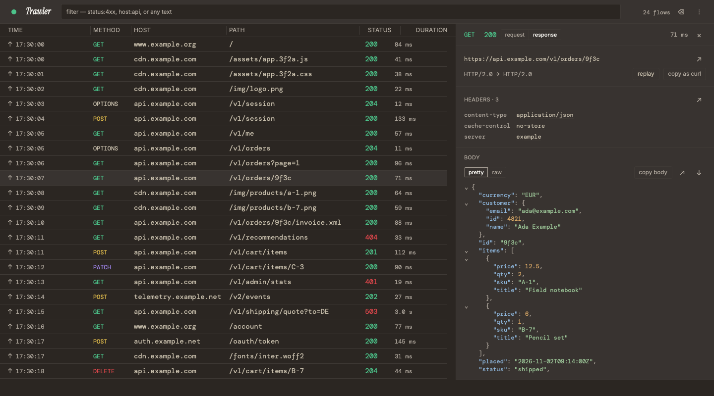
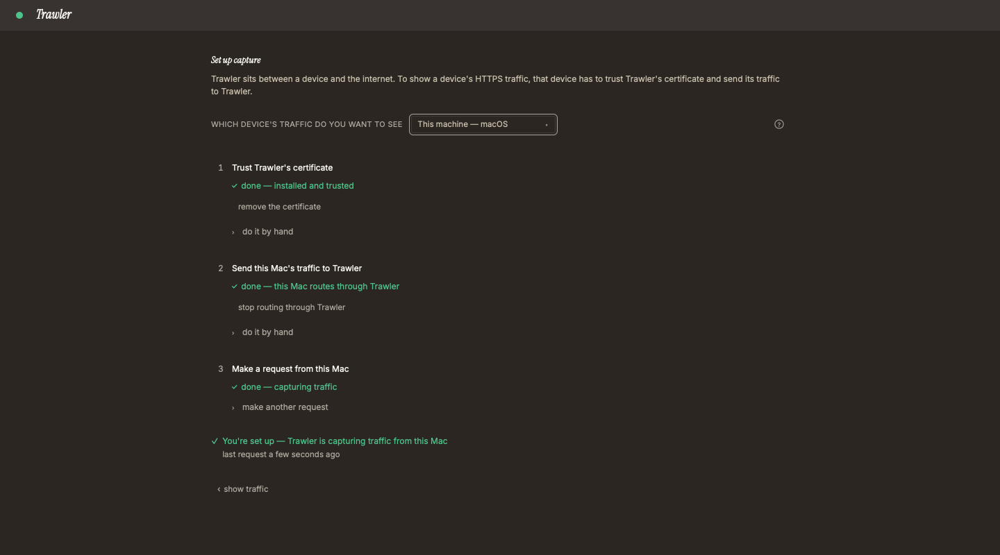
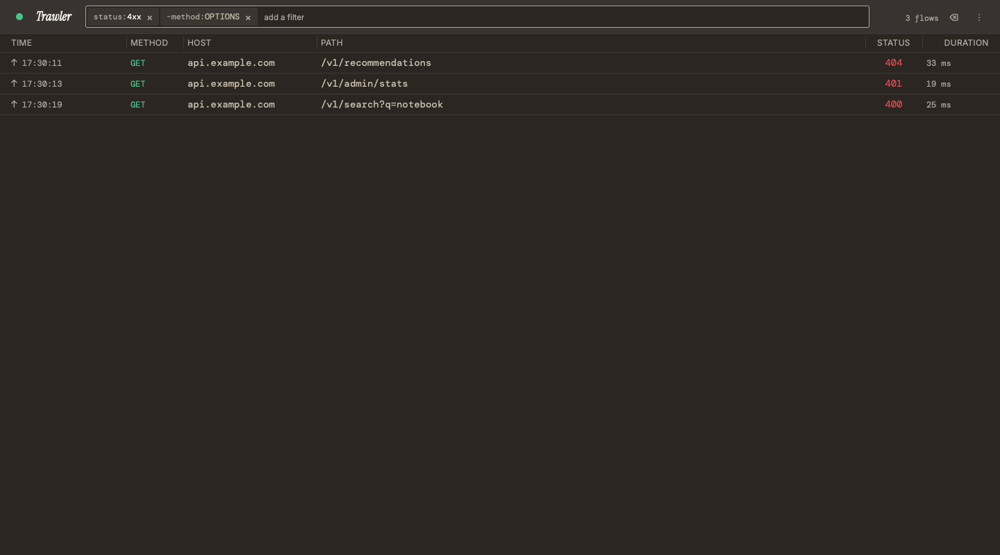
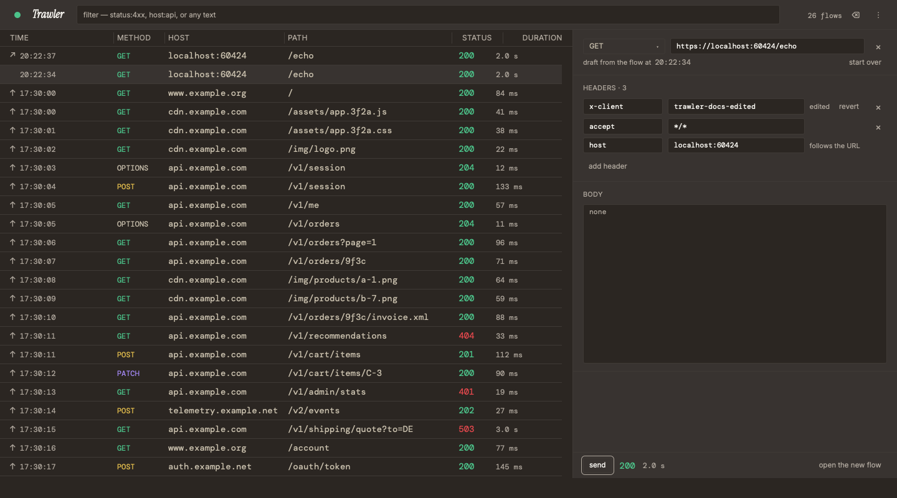

  <picture>
    <source media="(prefers-color-scheme: dark)" srcset="ui/src-tauri/icons/brand/wordmark-dark.png">
    
  </picture>

<h3 align="center">See every HTTP and HTTPS request your apps make.</h3>

  A free, open-source debugging proxy for macOS, Windows and Linux. Capture this machine, your phone or a simulator, read each request and send it again — everything stays on your machine.

  
  
  

<a href="#install">Download for macOS · Windows · Linux</a>

## What you can do

- Capture the HTTP and HTTPS traffic of this machine.
- Capture an iPhone, an Android phone, the iOS Simulator or the Android emulator, set up from one screen.
- Filter the list with chips such as `status:4xx` or `-method:OPTIONS`.
- Read headers, timing and bodies, with viewers for JSON, XML, HTML, forms and more.
- Send a request again, edited, or write one from scratch.
- Export what you captured to HAR, and open a HAR file.
- Keep capturing with the window closed, from the menu-bar or tray icon.

## Install

Download the file for your system from the [latest release](https://github.com/lesslucifer/Trawler/releases/latest).

| System | Download | First open |
|---|---|---|
| macOS 11 or later · Apple Silicon and Intel | `Trawler_<version>_universal.dmg` | **Privacy & Security → Open Anyway** |
| Windows x64 | `Trawler_<version>_x64-setup.exe` (recommended) · `Trawler_<version>_x64_en-US.msi` | **More info → Run anyway** |
| Windows arm64 | `Trawler_<version>_arm64-setup.exe` · `Trawler_<version>_arm64_en-US.msi` | **More info → Run anyway** |
| Linux x64 | `Trawler_<version>_amd64.AppImage` · `Trawler_<version>_amd64.deb` · `Trawler-<version>-1.x86_64.rpm` (final releases only) | no prompt |
| Linux arm64 | `Trawler_<version>_aarch64.AppImage` · `Trawler_<version>_arm64.deb` · `Trawler-<version>-1.aarch64.rpm` (final releases only) | no prompt |

Every installed copy updates itself from inside the app.

First open on macOS and Windows

Trawler isn't signed with a paid certificate, so macOS and Windows warn that they don't know the publisher. You do this once; updates install from inside Trawler.

- **macOS:** open Trawler from Applications, click **Done** on the warning, then open **System Settings → Privacy & Security**, scroll to the message about Trawler and click **Open Anyway**.
- **Windows:** when **Windows protected your PC** appears, click **More info**, then **Run anyway**.

Step by step, with pictures: [the guide](GUIDE.md#install).

Check your download

Each release has a `SHA256SUMS` file. Download it into the folder with your file, then run:

- macOS: `shasum -a 256 -c SHA256SUMS --ignore-missing`
- Linux: `sha256sum -c SHA256SUMS --ignore-missing`
- Windows (PowerShell): `(Get-FileHash .\<file> -Algorithm SHA256).Hash`, then compare it with that file's line in `SHA256SUMS`.

Your file must say `OK`, or the two hashes must match. If they don't, delete the file and download it again.

## First run

1. Open Trawler. The setup screen opens by itself.
2. Pick **This machine** and click **set up this Mac** (or **set up this PC**). It trusts Trawler's certificate and points the system proxy at Trawler. On Linux, the screen shows each step to do by hand.
3. Click **make a request to example.com**. Your requests now appear in the list.

To capture a phone or a simulator, open **⋮ → set up another device**. Every step, per system: [the guide](GUIDE.md#first-run).

## More screens

| Setup | Filters | Send again |
|---|---|---|
|  |  |  |

## Privacy

- Your captured traffic stays in memory on your machine and is gone when you quit. There is no account, analytics or telemetry.
- Trawler makes two requests of its own: an update check to GitHub when it opens (at most once a day; a switch in **Settings → General** turns it off), and the setup screen's test request to example.com when you click it.
- Trawler's certificate key is stored unencrypted in your app data folder. While the certificate is trusted, anyone who can read your user files could use it to read your HTTPS. Remove it when you stop using Trawler.

Details: [PRIVACY.md](PRIVACY.md).

## Known limits

- HTTP/3 traffic isn't captured: it goes around any HTTP proxy.
- Apps that pin their certificates refuse Trawler's, so their requests fail while capture is on.
- WebSocket: the opening request is captured; messages aren't shown.
- A body over 10 MB still reaches the app, but Trawler doesn't keep it.
- Captured requests are cleared when you quit. Export to HAR to keep them.
- Removing the certificate from the app works on macOS and Windows; on Linux, follow the steps on the setup screen.
- On GNOME, the tray icon needs the AppIndicator extension.
- Open at login needs macOS 13 or later.
- Updating a `.deb` or `.rpm` install asks for your password.
- `.rpm` is built for final releases only.

Workarounds: [the guide](GUIDE.md#troubleshooting).

## FAQ

Is it free?

Yes. MIT licence, no paid tier, no account.

Why does my computer warn me when I first open it?

Trawler isn't signed with a paid certificate. The warning is the OS saying it doesn't know the publisher. Check your download against `SHA256SUMS`, then follow the steps in [Install](#install).

Is it safe to trust Trawler's certificate?

The certificate is made on your machine and is unique to your install. While it's trusted, anyone who can read your user files could use its key to read your HTTPS. Remove it when you stop using Trawler ([the guide](GUIDE.md#uninstall)).

Does Trawler send my traffic anywhere?

No. It forwards each request to where it was going and keeps a copy in memory on your machine. See [PRIVACY.md](PRIVACY.md).

Where are captured requests saved?

Nowhere: they live in memory and go away when you quit. Export to HAR to keep them.

Why don't I see an app's traffic?

The app ignores the system proxy, pins its own certificates, or uses HTTP/3. See [Known limits](#known-limits).

Can I capture my phone, a simulator or an emulator?

Yes: iPhone, Android, the iOS Simulator and the Android emulator, from the setup screen.

How do updates work?

Trawler checks GitHub when it opens (at most once a day) and when you choose **Check for Updates…**. It asks before installing, and only installs a release signed by the project. A switch in **Settings → General** turns the check at opening off.

What can't it do?

Trawler has no breakpoints, rewrite rules or scripting language. It is native on macOS, Windows and Linux, open source and local-only.

Can I send a pull request?

Not yet. Bug reports and ideas are welcome as issues; see [CONTRIBUTING.md](CONTRIBUTING.md).

How do I remove it completely?

Turn the proxy off, remove the certificate, then the app and its data folder, in that order ([the guide](GUIDE.md#uninstall)).

## Scripting

Trawler has a local HTTP API on `127.0.0.1:7421` that lists, streams, exports and replays requests, for example `curl http://127.0.0.1:7421/flows`. The capture core also runs without the window (`cargo run -p trawler`). The API reference: [CONTRIBUTING.md](CONTRIBUTING.md#control-api).

## Contributing · Security · Licence

- Bug reports and ideas are welcome as issues: [CONTRIBUTING.md](CONTRIBUTING.md).
- Found a vulnerability? Report it privately: [SECURITY.md](SECURITY.md).
- Everyone here follows the [code of conduct](CODE_OF_CONDUCT.md).
- MIT © 2026 Vu Luu: [LICENSE](LICENSE). Third-party licences: [THIRD-PARTY-NOTICES.txt](THIRD-PARTY-NOTICES.txt).
